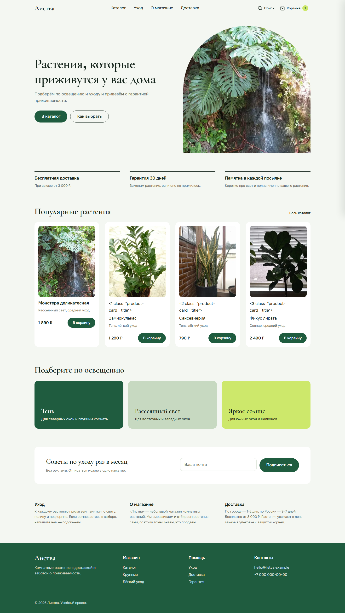
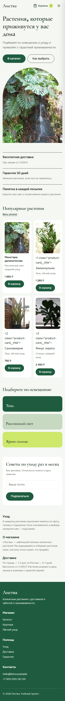
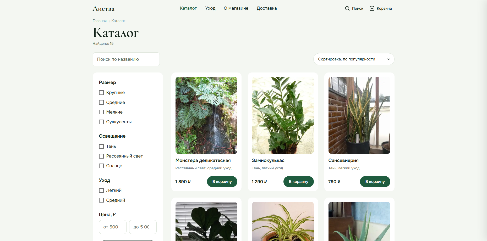
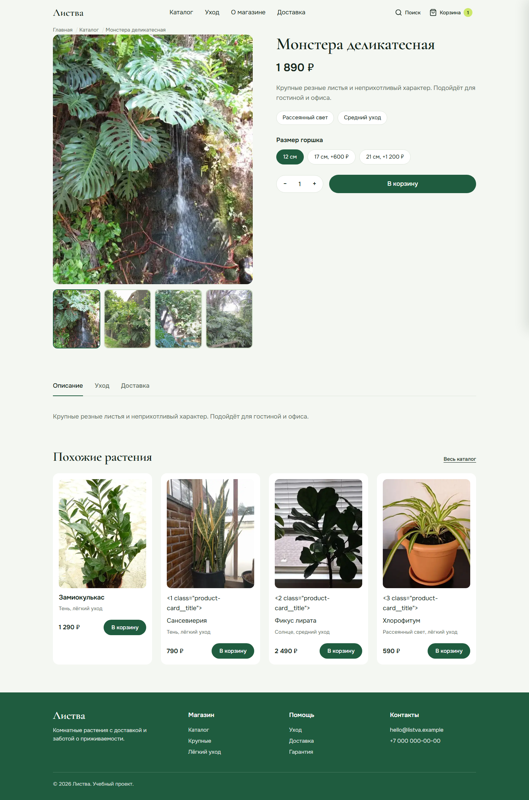

# Листва — интернет-магазин комнатных растений

Учебный проект: адаптивный интернет-магазин комнатных растений на чистом HTML, CSS и JavaScript.
Три страницы (главная, каталог, карточка товара) и выезжающая панель корзины.

**Опубликованный сайт:** _[добавить ссылку на GitHub Pages / Netlify]_

## Технологии

- HTML5 — семантическая разметка, валидный HTML
- CSS3 — Grid, Flexbox, переменные в `:root`, mobile-first, БЭМ
- JavaScript (ES6+) — данные, корзина, каталог, карточка товара, интерфейс
- Локальные шрифты Cormorant Garamond и Onest
- Без фреймворков, сборщиков и зависимостей

## Как запустить

Откройте `index.html` в браузере. Сайт полностью статичный — никакой сборки и зависимостей не требуется.

Через локальный сервер:

```bash
python -m http.server 8000
# или
npx serve .
```

После запуска откройте `http://localhost:8000`.

## Структура проекта

```
├── index.html            # главная
├── catalog.html          # каталог с фильтрами, сортировкой, поиском
├── product.html          # карточка товара (по ?id=)
├── css/                  # base.css, components.css, pages.css
├── js/                   # products.js, cart.js, catalog.js, product.js, main.js
├── img/                  # фотографии растений (WebP), hero, CREDITS.md
├── fonts/                # локальные шрифты
├── screenshots/          # скриншоты
├── robots.txt
└── README.md
```

## Скриншоты





